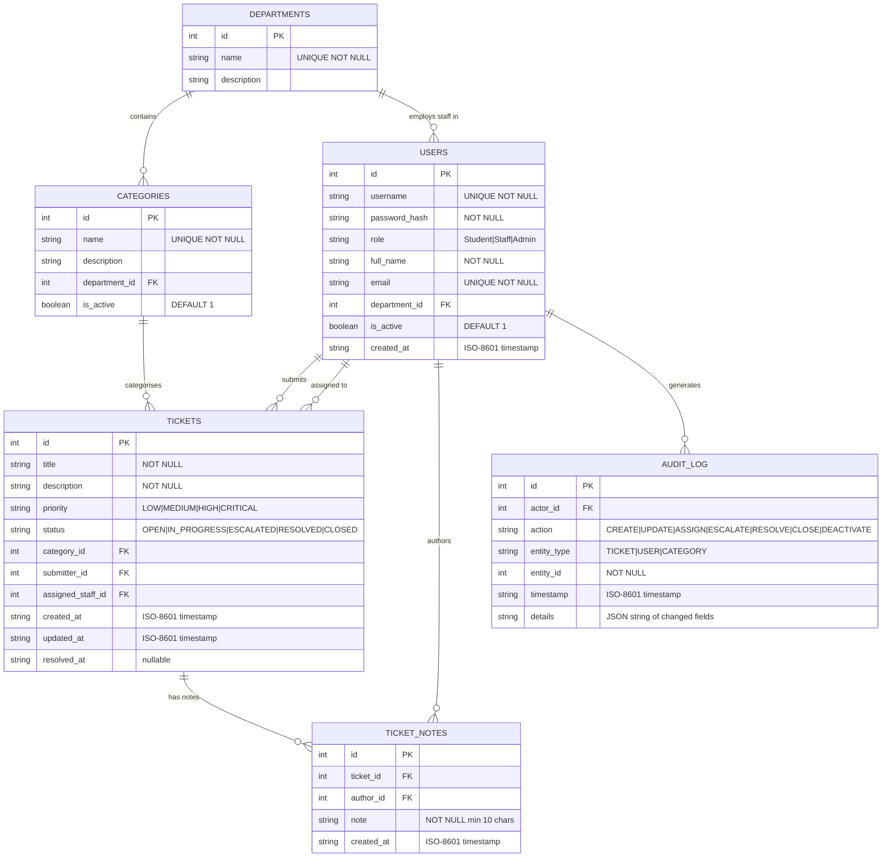

# Database Schema
## CampusFlow — Smart Campus Helpdesk & Queue Management System

> **Document ID**: ARCH-002
> **Version**: 1.0
> **Date**: 2026-11-19
> **Database**: SQLite 3 (`campusflow.db`)

---

## 1. Entity-Relationship Diagram



---

## 2. Table Descriptions

### 2.1 `users`

Stores all user accounts regardless of role.

| Column | Type | Constraints | Notes |
|---|---|---|---|
| `id` | INTEGER | PK AUTOINCREMENT | Surrogate key |
| `username` | TEXT | UNIQUE NOT NULL | Login name |
| `password_hash` | TEXT | NOT NULL | BCrypt hash — never plaintext |
| `role` | TEXT | NOT NULL CHECK | `'Student'`, `'Staff'`, `'Admin'` |
| `full_name` | TEXT | NOT NULL | Display name |
| `email` | TEXT | UNIQUE NOT NULL | Contact email |
| `department_id` | INTEGER | FK REFERENCES `departments(id)` NULL | Only set for Staff; NULL for Student/Admin |
| `is_active` | INTEGER | DEFAULT 1 | 1 = active, 0 = deactivated |
| `created_at` | TEXT | NOT NULL | ISO-8601 string |

### 2.2 `departments`

Defines the three service departments. Loaded at server startup; queues created dynamically.

| Column | Type | Constraints | Notes |
|---|---|---|---|
| `id` | INTEGER | PK AUTOINCREMENT | Surrogate key |
| `name` | TEXT | UNIQUE NOT NULL | e.g., `IT`, `Maintenance`, `Academic` |
| `description` | TEXT | | Optional description |

### 2.3 `categories`

Complaint categories, each belonging to exactly one department.

| Column | Type | Constraints | Notes |
|---|---|---|---|
| `id` | INTEGER | PK AUTOINCREMENT | Surrogate key |
| `name` | TEXT | UNIQUE NOT NULL | e.g., `Network Issue`, `Broken Equipment` |
| `description` | TEXT | | Optional description |
| `department_id` | INTEGER | FK NOT NULL | The owning department |
| `is_active` | INTEGER | DEFAULT 1 | 0 = cannot be used for new tickets |

### 2.4 `tickets`

Core entity. One row per complaint/service request.

| Column | Type | Constraints | Notes |
|---|---|---|---|
| `id` | INTEGER | PK AUTOINCREMENT | Ticket ID shown to users |
| `title` | TEXT | NOT NULL, max 150 | Short summary |
| `description` | TEXT | NOT NULL, max 2000 | Full complaint text |
| `priority` | TEXT | NOT NULL CHECK | `LOW`, `MEDIUM`, `HIGH`, `CRITICAL` |
| `status` | TEXT | NOT NULL CHECK | `OPEN`, `IN_PROGRESS`, `ESCALATED`, `RESOLVED`, `CLOSED` |
| `category_id` | INTEGER | FK NOT NULL | Link to `categories` |
| `submitter_id` | INTEGER | FK NOT NULL | Student who submitted |
| `assigned_staff_id` | INTEGER | FK NULL | NULL until assigned |
| `created_at` | TEXT | NOT NULL | ISO-8601 |
| `updated_at` | TEXT | NOT NULL | ISO-8601; updated on every status change |
| `resolved_at` | TEXT | NULL | ISO-8601; set when status → RESOLVED |

### 2.5 `ticket_notes`

Timeline notes attached to a ticket (staff updates, resolution notes, escalation reasons).

| Column | Type | Constraints | Notes |
|---|---|---|---|
| `id` | INTEGER | PK AUTOINCREMENT | Surrogate key |
| `ticket_id` | INTEGER | FK NOT NULL | Owning ticket |
| `author_id` | INTEGER | FK NOT NULL | Staff or Admin who wrote the note |
| `note` | TEXT | NOT NULL, min 10 | Note body |
| `created_at` | TEXT | NOT NULL | ISO-8601 |

### 2.6 `audit_log`

Immutable record of all state-changing operations. No UPDATE or DELETE is ever
performed on this table.

| Column | Type | Constraints | Notes |
|---|---|---|---|
| `id` | INTEGER | PK AUTOINCREMENT | Surrogate key |
| `actor_id` | INTEGER | FK NOT NULL | User who performed the action |
| `action` | TEXT | NOT NULL | `CREATE`, `UPDATE`, `ASSIGN`, `ESCALATE`, `RESOLVE`, `CLOSE`, `DEACTIVATE` |
| `entity_type` | TEXT | NOT NULL | `TICKET`, `USER`, `CATEGORY` |
| `entity_id` | INTEGER | NOT NULL | ID of the affected entity |
| `timestamp` | TEXT | NOT NULL | ISO-8601 |
| `details` | TEXT | | JSON string with before/after values or change summary |

---

## 3. SQLite DDL

```sql
-- ─────────────────────────────────────────────────
-- Enable foreign key enforcement (required per connection)
-- ─────────────────────────────────────────────────
PRAGMA foreign_keys = ON;
PRAGMA journal_mode = WAL;   -- Write-Ahead Logging for concurrent read access

-- ─────────────────────────────────────────────────
-- Table: departments
-- ─────────────────────────────────────────────────
CREATE TABLE IF NOT EXISTS departments (
    id          INTEGER PRIMARY KEY AUTOINCREMENT,
    name        TEXT    NOT NULL UNIQUE,
    description TEXT
);

-- ─────────────────────────────────────────────────
-- Table: users
-- ─────────────────────────────────────────────────
CREATE TABLE IF NOT EXISTS users (
    id              INTEGER PRIMARY KEY AUTOINCREMENT,
    username        TEXT    NOT NULL UNIQUE,
    password_hash   TEXT    NOT NULL,
    role            TEXT    NOT NULL CHECK (role IN ('Student', 'Staff', 'Admin')),
    full_name       TEXT    NOT NULL,
    email           TEXT    NOT NULL UNIQUE,
    department_id   INTEGER REFERENCES departments(id) ON DELETE SET NULL,
    is_active       INTEGER NOT NULL DEFAULT 1,
    created_at      TEXT    NOT NULL
);

-- ─────────────────────────────────────────────────
-- Table: categories
-- ─────────────────────────────────────────────────
CREATE TABLE IF NOT EXISTS categories (
    id            INTEGER PRIMARY KEY AUTOINCREMENT,
    name          TEXT    NOT NULL UNIQUE,
    description   TEXT,
    department_id INTEGER NOT NULL REFERENCES departments(id) ON DELETE RESTRICT,
    is_active     INTEGER NOT NULL DEFAULT 1
);

-- ─────────────────────────────────────────────────
-- Table: tickets
-- ─────────────────────────────────────────────────
CREATE TABLE IF NOT EXISTS tickets (
    id                INTEGER PRIMARY KEY AUTOINCREMENT,
    title             TEXT    NOT NULL CHECK (LENGTH(title) BETWEEN 1 AND 150),
    description       TEXT    NOT NULL CHECK (LENGTH(description) BETWEEN 1 AND 2000),
    priority          TEXT    NOT NULL CHECK (priority IN ('LOW','MEDIUM','HIGH','CRITICAL')),
    status            TEXT    NOT NULL CHECK (status IN ('OPEN','IN_PROGRESS','ESCALATED','RESOLVED','CLOSED'))
                              DEFAULT 'OPEN',
    category_id       INTEGER NOT NULL REFERENCES categories(id) ON DELETE RESTRICT,
    submitter_id      INTEGER NOT NULL REFERENCES users(id) ON DELETE RESTRICT,
    assigned_staff_id INTEGER          REFERENCES users(id) ON DELETE SET NULL,
    created_at        TEXT    NOT NULL,
    updated_at        TEXT    NOT NULL,
    resolved_at       TEXT
);

-- ─────────────────────────────────────────────────
-- Table: ticket_notes
-- ─────────────────────────────────────────────────
CREATE TABLE IF NOT EXISTS ticket_notes (
    id          INTEGER PRIMARY KEY AUTOINCREMENT,
    ticket_id   INTEGER NOT NULL REFERENCES tickets(id) ON DELETE CASCADE,
    author_id   INTEGER NOT NULL REFERENCES users(id) ON DELETE RESTRICT,
    note        TEXT    NOT NULL CHECK (LENGTH(note) >= 10),
    created_at  TEXT    NOT NULL
);

-- ─────────────────────────────────────────────────
-- Table: audit_log
-- ─────────────────────────────────────────────────
CREATE TABLE IF NOT EXISTS audit_log (
    id          INTEGER PRIMARY KEY AUTOINCREMENT,
    actor_id    INTEGER NOT NULL REFERENCES users(id) ON DELETE RESTRICT,
    action      TEXT    NOT NULL CHECK (action IN
                    ('CREATE','UPDATE','ASSIGN','ESCALATE','RESOLVE','CLOSE','DEACTIVATE')),
    entity_type TEXT    NOT NULL CHECK (entity_type IN ('TICKET','USER','CATEGORY')),
    entity_id   INTEGER NOT NULL,
    timestamp   TEXT    NOT NULL,
    details     TEXT
);
```

---

## 4. Indexes

```sql
-- Speed up ticket lookups by common filter combinations
CREATE INDEX IF NOT EXISTS idx_tickets_submitter
    ON tickets (submitter_id);

CREATE INDEX IF NOT EXISTS idx_tickets_assigned_staff
    ON tickets (assigned_staff_id);

CREATE INDEX IF NOT EXISTS idx_tickets_status
    ON tickets (status);

CREATE INDEX IF NOT EXISTS idx_tickets_priority
    ON tickets (priority);

CREATE INDEX IF NOT EXISTS idx_tickets_category
    ON tickets (category_id);

CREATE INDEX IF NOT EXISTS idx_ticket_notes_ticket
    ON ticket_notes (ticket_id);

CREATE INDEX IF NOT EXISTS idx_audit_log_actor
    ON audit_log (actor_id);

CREATE INDEX IF NOT EXISTS idx_audit_log_entity
    ON audit_log (entity_type, entity_id);
```

---

## 5. Seed Data

Inserted at first server startup if the tables are empty:

```sql
-- ── Departments ─────────────────────────────────────
INSERT OR IGNORE INTO departments (name, description) VALUES
    ('IT',          'Information Technology — network, software, hardware'),
    ('Maintenance', 'Facilities and physical infrastructure'),
    ('Academic',    'Academic administration and student services');

-- ── Default Categories ───────────────────────────────
INSERT OR IGNORE INTO categories (name, description, department_id) VALUES
    ('Network Issue',       'Wi-Fi, LAN, VPN problems',              1),
    ('Software Problem',    'Licensed software, lab computers',       1),
    ('Hardware Fault',      'Computers, printers, projectors',        1),
    ('Room Maintenance',    'Broken fixtures, cleaning issues',       2),
    ('Electrical Fault',    'Lighting, sockets, power failures',      2),
    ('Plumbing',            'Water supply, drainage issues',          2),
    ('Exam Query',          'Exam schedule, results, re-checks',      3),
    ('Enrollment Issue',    'Registration, course add/drop',          3),
    ('Document Request',    'Transcripts, letters, certificates',     3);

-- ── Seed Admin Account ──────────────────────────────
-- Password: admin123 (BCrypt hash — replace before use)
INSERT OR IGNORE INTO users
    (username, password_hash, role, full_name, email, is_active, created_at)
VALUES
    ('admin',
     '$2a$12$placeholder_hash_replace_before_use',
     'Admin',
     'System Administrator',
     'admin@campusflow.local',
     1,
     '2026-11-19T00:00:00');
```

---

## 6. Status Transition Rules

```
         ┌──────────┐
  submit │          │ claim / assign
         ▼          │
       OPEN ────────┴──► IN_PROGRESS ──► RESOLVED ──► CLOSED
         │                   │
         │                   │ escalate
         │                   ▼
         │              ESCALATED ────► IN_PROGRESS (after reassign)
         │
         └────────────────────────────────────────► CLOSED (admin force-close)
```

Enforced at the **Service Layer** (`TicketService.validateTransition()`), not at the
database level, to allow meaningful error messages.

---

## Document History

| Version | Date | Author | Notes |
|---|---|---|---|
| 1.0 | 2026-11-19 | Project Team | Initial schema |
