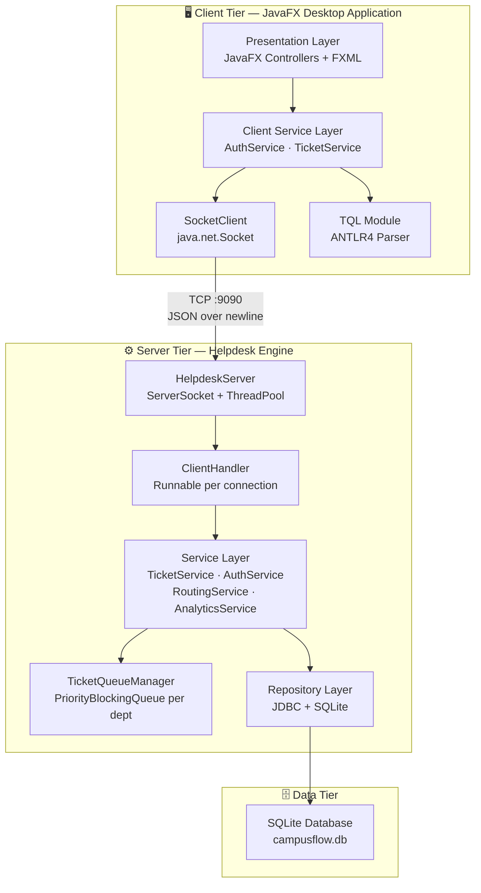
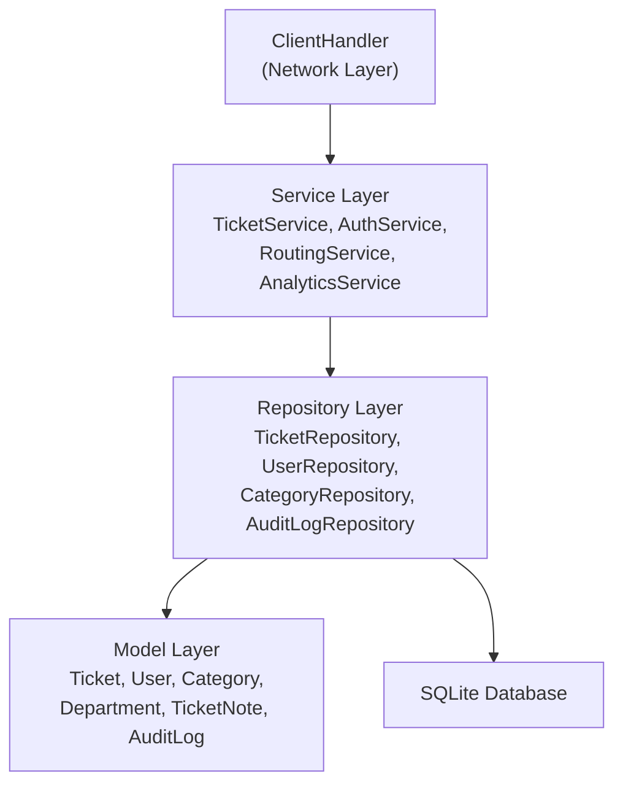

# System Architecture
## CampusFlow — Smart Campus Helpdesk & Queue Management System

> **Document ID**: ARCH-001
> **Version**: 1.0
> **Date**: 2026-11-19

---

## 1. Architectural Overview

CampusFlow uses a **Client-Server architecture** with a **Layered (N-Tier) design**
within each process. The two processes communicate over **TCP sockets** using a
newline-delimited JSON message protocol.

| Tier | Component | Technology |
|---|---|---|
| Client | JavaFX Desktop Application | Java 21, JavaFX 21, FXML |
| Server | Helpdesk Engine | Java 21, `java.net`, `java.util.concurrent` |
| Data | Embedded Database | SQLite via `sqlite-jdbc` |
| DSL | Ticket Query Language Parser | ANTLR4 (grammar → generated Java parser) |

---

## 2. High-Level Architecture Diagram



---

## 3. Layered Architecture — Server Side



**Strict layer rule**: Each layer communicates only with the layer directly below it.
`ClientHandler` never calls a repository directly. The UI never calls a repository.

---

## 4. Layer Descriptions

### 4.1 Presentation Layer (Client)

- **Technology**: JavaFX 21 + FXML
- **Controllers**: `LoginController`, `StudentDashboardController`,
  `StaffDashboardController`, `AdminDashboardController`, `SubmitTicketController`,
  `TicketDetailController`, `AnalyticsDashboardController`
- **Responsibility**: Render UI, capture user input, delegate all logic to the
  client-side service layer. Zero business logic in controllers.

### 4.2 Client Service Layer

- **`ClientAuthService`**: Manages login/logout, holds the current session token and
  logged-in user object in memory.
- **`ClientTicketService`**: Builds request objects, calls `SocketClient`, parses
  responses, and optionally delegates search queries to the TQL module.
- **`SocketClient`**: Wraps `java.net.Socket`; opens/closes connection; sends a
  request string and reads the response string (blocking I/O on a background thread).

### 4.3 TQL Module (Client + Server)

- **Technology**: ANTLR4 (`TicketQuery.g4` grammar → generated `TicketQueryLexer` +
  `TicketQueryParser` + `TicketQueryVisitor`)
- **Location**: Shared; grammar lives in `src/main/antlr4/com/campusflow/tql/`
- **Responsibility**: Parse a TQL query string into a structured `TicketFilter`
  object. The filter object is serialised into the `SEARCH_TICKETS` message payload
  and evaluated server-side by `TicketRepository.search(filter)`.

### 4.4 Network Layer (Server)

- **`HelpdeskServer`**: Opens a `ServerSocket` on port 9090, accepts connections in
  a loop, submits each accepted `Socket` to the `ExecutorService` thread pool.
- **`ClientHandler implements Runnable`**: Owns one client socket. Reads incoming
  messages line-by-line, dispatches to the correct service method based on message
  `type`, writes the response back.

### 4.5 Service Layer (Server)

| Service | Responsibility |
|---|---|
| `AuthService` | Credential verification (jBCrypt), session management (`ConcurrentHashMap`), inactivity sweep (`ScheduledExecutorService`) |
| `TicketService` | Ticket CRUD, submission workflow, status transitions |
| `RoutingService` | Determine target department from ticket category |
| `TicketQueueManager` | Maintain priority queues per department; thread-safe enqueue/dequeue |
| `AnalyticsService` | Aggregate query results with caching; `ReentrantReadWriteLock` |
| `UserManagementService` | CRUD for user accounts |
| `CategoryService` | CRUD for categories and departments |

### 4.6 Repository Layer (Server)

Each repository wraps JDBC calls against the SQLite database. All multi-step
operations use explicit transactions (`conn.setAutoCommit(false)`).

| Repository | Table(s) |
|---|---|
| `UserRepository` | `users` |
| `TicketRepository` | `tickets`, `ticket_notes` |
| `CategoryRepository` | `categories`, `departments` |
| `AuditLogRepository` | `audit_log` |

### 4.7 Model Layer

Plain Java objects (no framework annotations):
`User`, `Student`, `StaffMember`, `Admin`, `Ticket`, `TicketNote`,
`Category`, `Department`, `AuditLog`, `TicketFilter`, `Priority` (enum),
`TicketStatus` (enum), `Role` (enum), `MessageRequest`, `MessageResponse`.

---

## 5. Concurrency Architecture

### 5.1 Thread Model

```
HelpdeskServer Process (Standalone Java process)
  ├── Main Thread: ServerSocket.accept() [loop on configured port (e.g. 9090)]
  │     └── threadPool.submit(new ClientHandler(socket))
  │           ├── ClientHandler-1  (Worker Thread 1)
  │           ├── ClientHandler-2  (Worker Thread 2)
  │           ├── ...
  │           └── ClientHandler-N  (Worker Thread N, configured pool size: default 20)
  └── ScheduledExecutorService (Single Daemon Thread)
        └── Session Cleaner: runs every 5 minutes to sweep inactive sessions (> 30 min)
```

### 5.2 Thread-Safe Components

| Component | Mechanism | Justification |
|---|---|---|
| `TicketQueueManager` | `PriorityBlockingQueue<Ticket>` per dept | Blocking queue is intrinsically thread-safe; `take()` blocks until a ticket is available |
| `AuthService` sessions | `ConcurrentHashMap<String, Session>` | Lock-free concurrent reads; atomic put/remove for session lifecycle |
| `Session Cleaner` | `ScheduledExecutorService` (daemon) | Periodically removes sessions inactive for > 30 minutes safely from `ConcurrentHashMap` |
| `AnalyticsService` cache | `ReentrantReadWriteLock` | Multiple threads may read the cache simultaneously; writes (invalidation) are exclusive |
| SQLite access | `synchronized` on shared `Connection` per thread or `HikariCP`-style pool | SQLite in WAL mode supports concurrent readers; writes are serialised |
| `TicketService.submit()` | Relies on `PriorityBlockingQueue.put()` thread safety | No additional lock needed beyond the queue itself |
| Configuration | `ServerConfig` from `server.properties` | Loaded immutably at server startup |

### 5.3 Lock Ordering (Deadlock Prevention)

Locks are always acquired in a fixed global order:
1. `AnalyticsService.cacheLock` (if needed)
2. Database connection lock

No code path acquires these in reverse order.

---

## 6. Socket Communication Protocol

### 6.1 Connection Lifecycle

```
Client                          Server
  |                               |
  |── TCP connect :9090 ─────────►|
  |                               | (ClientHandler spawned)
  |── { type: LOGIN, ... } ──────►|
  |◄─ { status: OK, data: {...} } |
  |                               |
  |── { type: SUBMIT_TICKET, sessionId, payload } ──►|
  |◄─ { status: OK, data: { ticketId: 42 } }         |
  |                               |
  |── { type: LOGOUT, sessionId } ─────────────────►|
  |◄─ { status: OK }                                 |
  |── TCP close ─────────────────►|
```

### 6.2 Message Format

**Request**:
```json
{
  "type": "MESSAGE_TYPE",
  "sessionId": "uuid-string-or-null-for-login",
  "payload": { }
}
```

**Response**:
```json
{
  "status": "OK | ERROR",
  "errorCode": "OPTIONAL_ERROR_CODE",
  "data": { }
}
```

**Error Codes**: `AUTH_FAILED`, `SESSION_EXPIRED`, `NOT_FOUND`, `FORBIDDEN`,
`VALIDATION_ERROR`, `SERVER_ERROR`

### 6.3 Framing

Messages are terminated by a single newline character (`\n`). The receiver reads
with `BufferedReader.readLine()`. This avoids the need for a length-prefix framing
protocol while remaining simple to debug.

---

## 7. ANTLR4 / Little Language — Ticket Query Language (TQL)

### 7.1 Motivation

TQL is a domain-specific language that allows users to filter tickets using
structured queries instead of ad-hoc UI checkboxes. It demonstrates parser generator
and grammar concepts from the SCD curriculum.

### 7.2 Grammar (`TicketQuery.g4`)

```antlr
grammar TicketQuery;

// Parser Rules
query       : filterExpr (AND filterExpr)* EOF ;
filterExpr  : FIELD COLON value                ;
value       : STRING
            | QUOTED_STRING
            ;

// Lexer Rules
AND          : 'AND'                           ;
FIELD        : 'status'
             | 'priority'
             | 'category'
             | 'department'
             | 'assigned'
             | 'submitter'
             ;
COLON        : ':'                             ;
STRING       : [a-zA-Z_][a-zA-Z0-9_]*         ;
QUOTED_STRING: '"' (~["\r\n])* '"'            ;
WS           : [ \t\r\n]+ -> skip             ;
```

### 7.3 Valid TQL Queries

```
status:open
priority:high
status:open AND priority:critical
category:"IT Support" AND status:escalated
department:Maintenance AND assigned:john
priority:critical AND department:IT AND status:open
```

### 7.4 Processing Pipeline

```
User types TQL string (Student, Staff, or Admin)
        │
        ▼
  TicketQueryLexer   (ANTLR-generated)
        │  tokens
        ▼
  TicketQueryParser  (ANTLR-generated)
        │  parse tree
        ▼
  TicketQueryVisitor (custom implementation)
        │  TicketFilter object
        ▼
  Server Authorization & Scoping (Server-side):
  TicketRepository.search(filter, role, userId)
  ├── Student: enforces `AND submitter_id = ?` (cannot view other tickets)
  ├── Staff:   enforces department / assigned scope
  └── Admin:   full global query access
        │  parameterised SQL query
        ▼
  List<Ticket> returned to Client UI
```

### 7.5 Maven Configuration for ANTLR

```xml
<!-- To be added in implementation phase -->
<dependency>
    <groupId>org.antlr</groupId>
    <artifactId>antlr4-runtime</artifactId>
    <version>4.13.1</version>
</dependency>
<plugin>
    <groupId>org.antlr</groupId>
    <artifactId>antlr4-maven-plugin</artifactId>
    <version>4.13.1</version>
    <executions>
        <execution>
            <goals><goal>antlr4</goal></goals>
        </execution>
    </executions>
</plugin>
```

---

## 8. Package Structure (Planned)

```
com.campusflow
├── server/
│   ├── HelpdeskServer.java
│   ├── ServerConfig.java
│   └── ClientHandler.java
├── service/
│   ├── AuthService.java
│   ├── TicketService.java
│   ├── RoutingService.java
│   ├── TicketQueueManager.java
│   ├── AnalyticsService.java
│   ├── UserManagementService.java
│   └── CategoryService.java
├── repository/
│   ├── UserRepository.java
│   ├── TicketRepository.java
│   ├── CategoryRepository.java
│   └── AuditLogRepository.java
├── model/
│   ├── User.java
│   ├── Student.java
│   ├── StaffMember.java
│   ├── Admin.java
│   ├── Ticket.java
│   ├── TicketNote.java
│   ├── Category.java
│   ├── Department.java
│   ├── AuditLog.java
│   ├── enums/
│   │   ├── Role.java
│   │   ├── Priority.java
│   │   └── TicketStatus.java
│   └── protocol/
│       ├── MessageRequest.java
│       └── MessageResponse.java
├── tql/
│   ├── TicketQuery.g4            (ANTLR grammar source)
│   ├── TicketFilter.java
│   └── TicketQueryVisitorImpl.java
├── client/
│   ├── SocketClient.java
│   ├── ClientAuthService.java
│   └── ClientTicketService.java
├── ui/
│   ├── LoginController.java
│   ├── StudentDashboardController.java
│   ├── StaffDashboardController.java
│   ├── AdminDashboardController.java
│   ├── SubmitTicketController.java
│   ├── TicketDetailController.java
│   └── AnalyticsDashboardController.java
├── util/
│   ├── DatabaseManager.java
│   ├── PasswordUtil.java
│   └── JsonUtil.java
└── Main.java
```

---

## Document History

| Version | Date | Author | Notes |
|---|---|---|---|
| 1.0 | 2026-11-19 | Project Team | Initial architecture document |
