# Use Cases & User Workflows
## CampusFlow — Smart Campus Helpdesk & Queue Management System

> **Document ID**: REQ-002
> **Version**: 1.0
> **Date**: 2026-11-19

---

## 1. Actor Summary

| Actor | Type | Description |
|---|---|---|
| **Student** | Primary | Submits and tracks campus service complaints |
| **Staff Member** | Primary | Receives, processes, and resolves assigned tickets |
| **Administrator** | Primary | Manages users, categories, all tickets, and views analytics |
| **CampusFlow Server** | System | Handles queuing, routing, session management, and persistence |

---

## 2. Use Case Diagram

```mermaid
flowchart TD
    Student(["👤 Student"])
    Staff(["👤 Staff Member"])
    Admin(["👤 Administrator"])
    System(["⚙️ System"])

    subgraph AUTH["Authentication"]
        UC01["UC-01\nLogin / Logout"]
    end

    subgraph STUDENT_UCS["Student Use Cases"]
        UC02["UC-02\nSubmit Complaint"]
        UC03["UC-03\nTrack Ticket Status"]
        UC04["UC-04\nView Ticket History"]
        UC08["UC-08\nSearch Tickets (TQL)"]
    end

    subgraph STAFF_UCS["Staff Use Cases"]
        UC05["UC-05\nClaim Next Ticket"]
        UC06["UC-06\nUpdate Ticket Status"]
        UC07["UC-07\nEscalate Ticket"]
        UC09["UC-09\nView Assigned Queue"]
    end

    subgraph ADMIN_UCS["Admin Use Cases"]
        UC10["UC-10\nManage User Accounts"]
        UC11["UC-11\nAssign Ticket to Staff"]
        UC12["UC-12\nManage Categories"]
        UC13["UC-13\nTicket Override"]
        UC14["UC-14\nView Analytics Dashboard"]
        UC15["UC-15\nView Audit Log"]
    end

    subgraph SYSTEM_UCS["System Use Cases"]
        UC16["UC-16\nRoute Ticket to Queue"]
        UC17["UC-17\nLog Audit Entry"]
    end

    Student --> UC01
    Staff   --> UC01
    Admin   --> UC01

    Student --> UC02
    Student --> UC03
    Student --> UC04
    Student --> UC08

    Staff --> UC05
    Staff --> UC06
    Staff --> UC07
    Staff --> UC09
    Staff --> UC08

    Admin --> UC10
    Admin --> UC11
    Admin --> UC12
    Admin --> UC13
    Admin --> UC14
    Admin --> UC15
    Admin --> UC08

    UC02 --> UC16
    UC06 --> UC17
    UC02 --> UC17
    UC10 --> UC17
    UC11 --> UC17
    UC07 --> UC17
```

---

## 3. Detailed Use Cases

---

### UC-01 — Login / Logout

| Field | Detail |
|---|---|
| **ID** | UC-01 |
| **Name** | Login / Logout |
| **Actors** | Student, Staff, Admin |
| **Related FR** | FR-02 |
| **Preconditions** | User account exists and is active; server is running |
| **Postconditions (success)** | Session token issued; user directed to role-appropriate dashboard |
| **Postconditions (failure)** | Error message shown; no session created |

**Main Success Flow**:
1. User launches CampusFlow client; Login screen is displayed.
2. User enters username and password; clicks **Login**.
3. `ClientTicketService` sends `{ type: "LOGIN", payload: { username, password } }` via socket.
4. Server's `AuthService` looks up user by username; verifies password hash using jBCrypt (`PasswordUtil.verify()`).
5. Server creates `Session(uuid, userId, role, createdAt, lastAccessedAt)`, stores in `ConcurrentHashMap`.
6. Server responds `{ status: "OK", data: { sessionId, role, fullName } }`.
7. Client stores session token; navigates to role dashboard.

**Alternate Flow — Wrong Credentials**:
- Step 4 fails. Server responds `{ status: "ERROR", errorCode: "AUTH_FAILED" }`.
- Client shows "Invalid username or password."

**Alternate Flow — Deactivated Account**:
- Step 4 finds user but `is_active = 0`. Server responds `AUTH_FAILED`.

**Alternate Flow — Inactivity Session Expiry (30 minutes)**:
- User remains inactive for ≥ 30 minutes without sending requests.
- Server's `ScheduledExecutorService` session cleaner sweeps the expired session from `ConcurrentHashMap`.
- When user subsequently triggers an action, server responds `{ status: "ERROR", errorCode: "SESSION_EXPIRED" }`.
- Client notifies user ("Session expired due to inactivity. Please log in again.") and routes to Login screen.

**Logout Flow**:
1. User clicks **Logout**.
2. Client sends `{ type: "LOGOUT", sessionId }`.
3. Server removes session from `ConcurrentHashMap`.
4. Client clears local session; returns to Login screen.

---

### UC-02 — Submit Complaint

| Field | Detail |
|---|---|
| **ID** | UC-02 |
| **Name** | Submit Complaint |
| **Actors** | Student |
| **Related FR** | FR-03, FR-05, FR-09, FR-11, FR-14 |
| **Preconditions** | Student is authenticated; at least one active category exists |
| **Postconditions** | Ticket persisted with `OPEN` status; enqueued in department `PriorityBlockingQueue`; audit log entry created |

**Main Success Flow**:
1. Student clicks **Submit New Complaint** on dashboard.
2. `SubmitTicketController` loads the form; populates category dropdown via `GET_CATEGORIES` message.
3. Student fills: **Title**, **Description**, selects **Category**, selects **Priority** (default: MEDIUM).
4. Student clicks **Submit**.
5. Controller validates input (title 1–150 chars, description 1–2000 chars).
6. `ClientTicketService` sends `SUBMIT_TICKET` message.
7. Server `ClientHandler` validates session; delegates to `TicketService.submitTicket(dto)`.
8. `TicketService` builds `Ticket` object; calls `TicketRepository.save(ticket)` inside a transaction.
9. `RoutingService.route(ticket)` → determines department from category.
10. `TicketQueueManager.enqueue(ticket, department)` → `PriorityBlockingQueue.put(ticket)`.
11. `AuditLogRepository.log(studentId, CREATE, TICKET, ticketId)`.
12. Server responds `{ status: "OK", data: { ticketId: 42 } }`.
13. Client shows confirmation: **"Ticket #42 submitted. We'll keep you updated."**

**Alternate Flow — Validation Error**:
- Step 5: Title empty. Controller shows inline validation error; does not send to server.

**Alternate Flow — Server Error**:
- Step 8: DB write fails. `TicketService` rolls back transaction; responds `{ status: "ERROR", errorCode: "SERVER_ERROR" }`.

---

### UC-03 — Track Ticket Status

| Field | Detail |
|---|---|
| **ID** | UC-03 |
| **Name** | Track Ticket Status |
| **Actors** | Student |
| **Related FR** | FR-04, FR-11 |
| **Preconditions** | Student is authenticated |
| **Postconditions** | Read-only display; no state change |

**Main Success Flow**:
1. Student views **My Tickets** list on dashboard (loaded via `GET_MY_TICKETS`).
2. Student clicks on a ticket row.
3. Client sends `GET_TICKET` with `ticketId`.
4. Server returns ticket details including: status, priority, assigned staff name, all `ticket_notes` (chronological).
5. `TicketDetailController` displays a timeline view of notes and status changes.

---

### UC-04 — View Ticket History

| Field | Detail |
|---|---|
| **ID** | UC-04 |
| **Name** | View Ticket History |
| **Actors** | Student |
| **Related FR** | FR-04 |
| **Preconditions** | Student is authenticated |
| **Postconditions** | Read-only |

**Main Success Flow**:
1. Student navigates to **My Tickets** list (default view on dashboard).
2. Client sends `GET_MY_TICKETS`; server returns all tickets submitted by this student, ordered by `created_at` DESC.
3. Student can filter by status using the status dropdown.
4. Clicking a ticket opens UC-03.

---

### UC-05 — Claim Next Ticket

| Field | Detail |
|---|---|
| **ID** | UC-05 |
| **Name** | Claim Next Ticket from Queue |
| **Actors** | Staff Member |
| **Related FR** | FR-06, FR-09, FR-14 |
| **Preconditions** | Staff is authenticated; staff has a `department_id` assigned |
| **Postconditions** | Highest-priority `OPEN` ticket in staff's department dequeued; assigned to staff; status → `IN_PROGRESS` |

**Main Success Flow**:
1. Staff clicks **Claim Next Ticket** on the Staff Dashboard.
2. Client sends `CLAIM_TICKET` message (no payload needed; server uses session's `department_id`).
3. Server `TicketService.claimNextTicket(staffId, departmentId)`:
   a. `TicketQueueManager.dequeue(department)` → `PriorityBlockingQueue.poll()` returns highest-priority ticket.
   b. Sets `assigned_staff_id = staffId`, `status = IN_PROGRESS`, `updated_at = now`.
   c. `TicketRepository.update(ticket)`.
   d. `AuditLogRepository.log(staffId, ASSIGN, TICKET, ticketId)`.
4. Server responds with the full ticket object.
5. Staff Dashboard updates to show the newly claimed ticket.

**Alternate Flow — Queue Empty**:
- Step 3a: `poll()` returns null. Server responds `{ status: "OK", data: { message: "No tickets in your queue" } }`.

---

### UC-06 — Update Ticket Status / Resolve Ticket

| Field | Detail |
|---|---|
| **ID** | UC-06 |
| **Name** | Update Ticket Status / Resolve Ticket |
| **Actors** | Staff Member |
| **Related FR** | FR-07, FR-15, FR-14 |
| **Preconditions** | Ticket is assigned to this staff member and is `IN_PROGRESS` |
| **Postconditions** | Status updated; note persisted; audit log entry created |

**Main Success Flow (Resolve)**:
1. Staff opens ticket detail; clicks **Resolve**.
2. A dialog prompts for a resolution note (min 10 chars).
3. Client sends `UPDATE_TICKET_STATUS` with `{ ticketId, newStatus: "RESOLVED", note }`.
4. Server validates: ticket exists, `assigned_staff_id == requestingStaffId`, current status is `IN_PROGRESS`.
5. `TicketService.updateStatus()` inside a transaction:
   a. Update ticket `status = RESOLVED`, `resolved_at = now`, `updated_at = now`.
   b. Insert `ticket_note`.
   c. Insert `audit_log` entry.
6. Server responds `{ status: "OK" }`.
7. Staff dashboard refreshes; ticket removed from "In Progress" panel.

**Alternate Flow — Insufficient Note Length**:
- Step 2: Client validates note length < 10 chars; shows inline error without sending.

---

### UC-07 — Escalate Ticket

| Field | Detail |
|---|---|
| **ID** | UC-07 |
| **Name** | Escalate Ticket |
| **Actors** | Staff Member |
| **Related FR** | FR-08, FR-14 |
| **Preconditions** | Ticket assigned to staff; status is `IN_PROGRESS` |
| **Postconditions** | Status → `ESCALATED`; re-enqueued with priority bump; audit log entry created |

**Main Success Flow**:
1. Staff clicks **Escalate** on a ticket they cannot resolve.
2. Staff enters escalation reason (min 10 chars).
3. Client sends `ESCALATE_TICKET` with `{ ticketId, reason }`.
4. Server `TicketService.escalateTicket()`:
   a. Bumps priority by one level (LOW→MEDIUM, MEDIUM→HIGH, HIGH→CRITICAL; CRITICAL stays CRITICAL).
   b. Sets `status = ESCALATED`, clears `assigned_staff_id`.
   c. Persists changes in a transaction with note + audit log.
   d. `TicketQueueManager.enqueue(ticket, department)` with new priority.
5. Server responds `{ status: "OK" }`.

---

### UC-08 — Search Tickets with TQL

| Field | Detail |
|---|---|
| **ID** | UC-08 |
| **Name** | Search Tickets using TQL |
| **Actors** | Student (own), Staff (assigned), Admin (all) |
| **Related FR** | FR-12 |
| **Preconditions** | User is authenticated |
| **Postconditions** | Filtered ticket list returned |

**Main Success Flow**:
1. User types a TQL query in the search bar (e.g., `status:open AND priority:high`).
2. `ClientTicketService` calls `TQLParser.parse(queryString)` → `TicketFilter` object.
3. If parse fails, inline syntax error shown; no server request sent.
4. Client sends `SEARCH_TICKETS` with serialised filter in payload.
5. Server's `TicketRepository.search(filter)` builds a parameterised SQL query from the filter fields.
6. Results scoped by role with strict server-side authorization: Students only ever see their own tickets (`WHERE submitter_id = ?` injected by server); Staff only see department or assigned tickets; Admin sees all tickets. Any client-side filter parameters attempting to access other users' tickets are overridden and suppressed server-side.
7. Results returned sorted by priority (CRITICAL first), then `created_at`.

---

### UC-09 — View Assigned Queue

| Field | Detail |
|---|---|
| **ID** | UC-09 |
| **Name** | View Assigned Ticket Queue |
| **Actors** | Staff Member |
| **Related FR** | FR-04 |
| **Preconditions** | Staff is authenticated |
| **Postconditions** | Read-only |

**Main Success Flow**:
1. Staff dashboard loads; sends `GET_ASSIGNED_TICKETS`.
2. Server returns all `IN_PROGRESS` tickets assigned to this staff member, ordered by priority.
3. Staff can click any ticket to view details (UC-03), resolve (UC-06), or escalate (UC-07).

---

### UC-10 — Manage User Accounts

| Field | Detail |
|---|---|
| **ID** | UC-10 |
| **Name** | Manage User Accounts |
| **Actors** | Administrator |
| **Related FR** | FR-01, FR-14 |
| **Preconditions** | Admin is authenticated |
| **Postconditions** | User created or deactivated; audit log entry created |

**Create User Flow**:
1. Admin opens **User Management** panel; clicks **New User**.
2. Admin fills: username, password, full name, email, role, department (if Staff).
3. Client sends `CREATE_USER` with payload.
4. Server `UserManagementService.createUser()`: hashes password with BCrypt; inserts into `users`; logs audit entry.
5. Confirmation shown.

**Deactivate User Flow**:
1. Admin selects a user; clicks **Deactivate**.
2. Confirmation dialog shown.
3. Client sends `DEACTIVATE_USER` with `{ userId }`.
4. Server sets `is_active = 0`; logs audit entry. All existing sessions for this user are invalidated.

---

### UC-11 — Assign Ticket to Staff

| Field | Detail |
|---|---|
| **ID** | UC-11 |
| **Name** | Admin Assign Ticket to Staff |
| **Actors** | Administrator |
| **Related FR** | FR-06, FR-14 |
| **Preconditions** | Admin is authenticated; ticket is `OPEN` or `ESCALATED` |
| **Postconditions** | Ticket assigned; status → `IN_PROGRESS` |

---

### UC-12 — Manage Categories

| Field | Detail |
|---|---|
| **ID** | UC-12 |
| **Name** | Manage Complaint Categories |
| **Actors** | Administrator |
| **Related FR** | FR-16 |
| **Preconditions** | Admin is authenticated |
| **Postconditions** | Category created or deactivated; audit log entry created |

---

### UC-13 — Ticket Override

| Field | Detail |
|---|---|
| **ID** | UC-13 |
| **Name** | Admin Ticket Override |
| **Actors** | Administrator |
| **Related FR** | FR-17 |
| **Preconditions** | Admin is authenticated |
| **Postconditions** | Ticket updated per override; audit log entry created |

---

### UC-14 — View Analytics Dashboard

| Field | Detail |
|---|---|
| **ID** | UC-14 |
| **Name** | View Analytics Dashboard |
| **Actors** | Administrator |
| **Related FR** | FR-13 |
| **Preconditions** | Admin is authenticated |
| **Postconditions** | Analytics data returned (read-only) |

**Main Success Flow**:
1. Admin opens **Analytics** panel.
2. Client sends `GET_ANALYTICS`.
3. Server `AnalyticsService.getReport()`:
   a. Acquires **read lock** (`ReentrantReadWriteLock.readLock().lock()`).
   b. If cache is valid, returns cached result; releases read lock.
   c. If cache is stale, upgrades to **write lock**, queries database, updates cache, releases write lock.
4. Analytics payload returned: ticket volume by status, by category, avg resolution time per department, open tickets per staff member.
5. `AnalyticsDashboardController` renders charts (JavaFX `PieChart`, `BarChart`, `LineChart`).

---

### UC-15 — View Audit Log

| Field | Detail |
|---|---|
| **ID** | UC-15 |
| **Name** | View Audit Log |
| **Actors** | Administrator |
| **Related FR** | FR-14 |
| **Preconditions** | Admin is authenticated |
| **Postconditions** | Read-only |

---

## Document History

| Version | Date | Author | Notes |
|---|---|---|---|
| 1.0 | 2026-11-19 | Project Team | Initial use case document |
