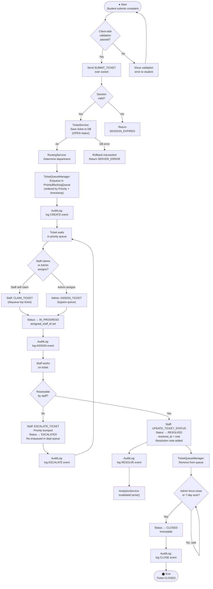
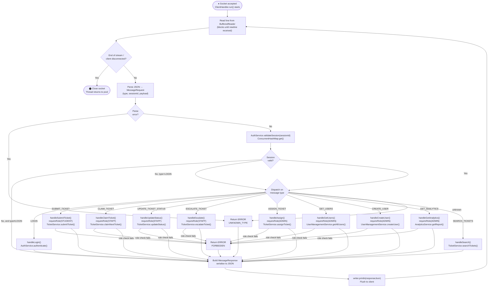
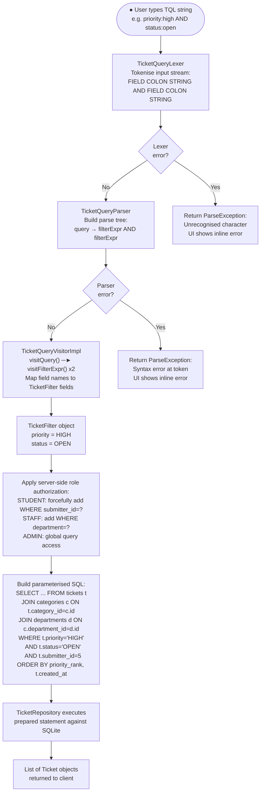
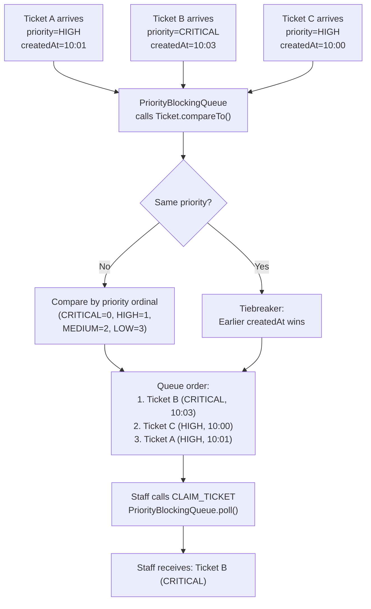

# UML Activity Diagrams
## CampusFlow — Smart Campus Helpdesk & Queue Management System

> **Document ID**: UML-003
> **Version**: 1.0
> **Date**: 2026-11-19

---

## AD-01 — Complete Ticket Lifecycle

This diagram shows the full lifecycle of a ticket from submission through resolution
and closure, including escalation and admin override paths.

---

## AD-02 — Server Request Processing

This diagram shows how `ClientHandler` processes every incoming TCP message,
covering authentication, role authorisation, dispatch, and error handling.

---

## AD-03 — TQL Query Processing Pipeline

Shows how a raw TQL string flows through the ANTLR-generated parser into a SQL query.

---

## AD-04 — Priority Queue Ordering

Illustrates how `Ticket.compareTo()` governs ordering inside `PriorityBlockingQueue`.

---

## Document History

| Version | Date | Author | Notes |
|---|---|---|---|
| 1.0 | 2026-11-19 | Project Team | Initial activity diagrams |
