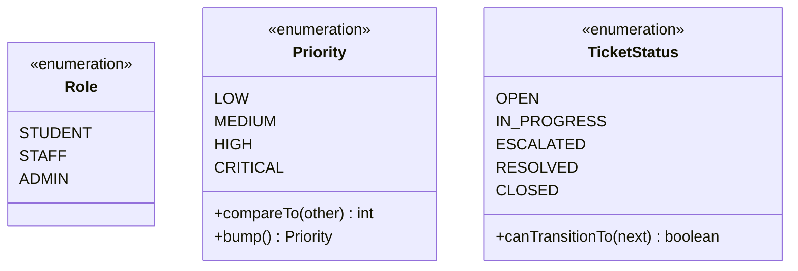
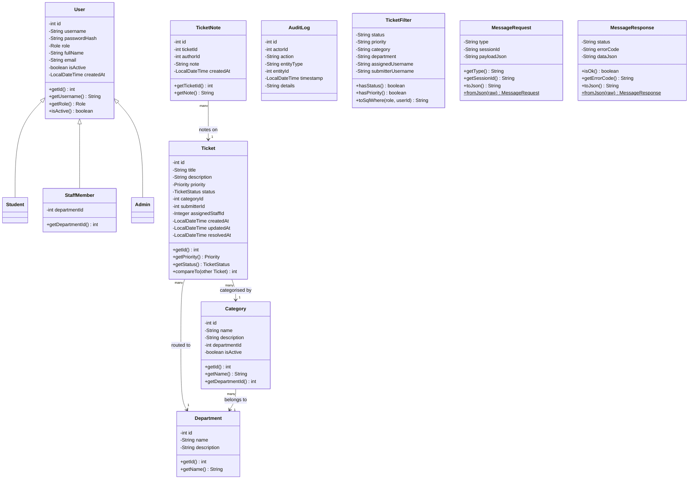
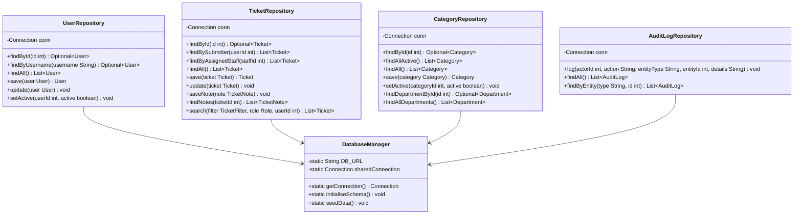
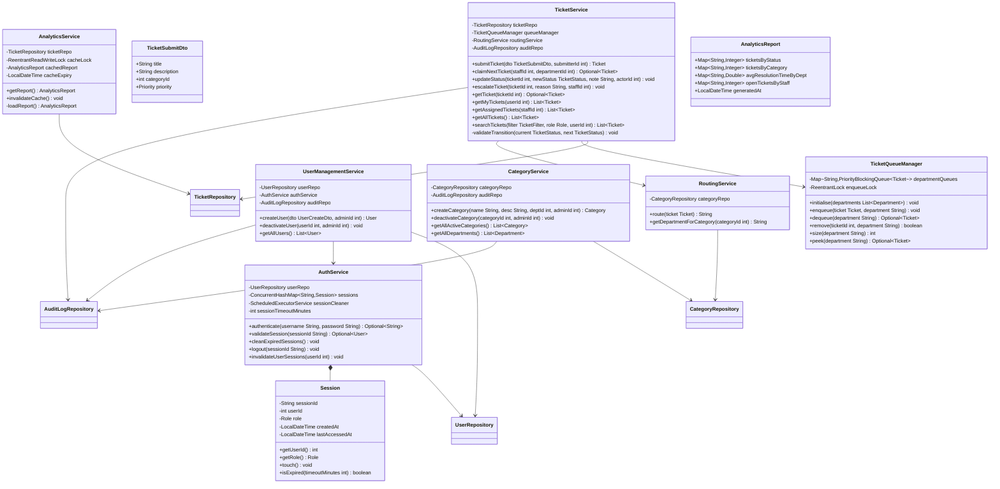
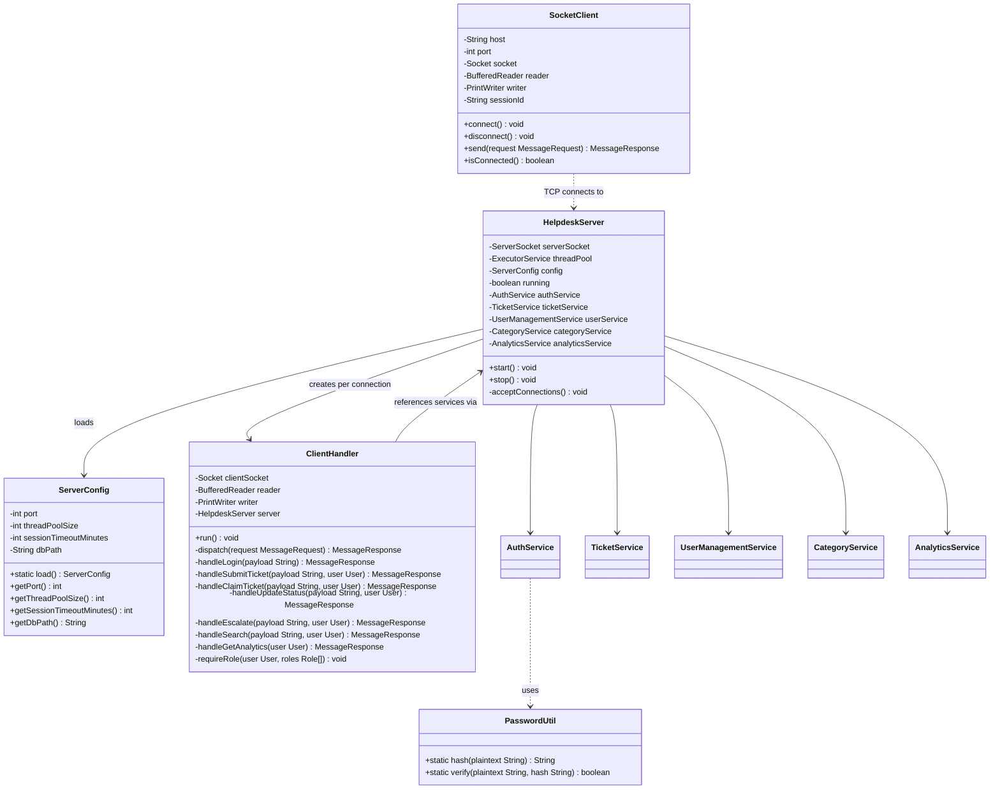
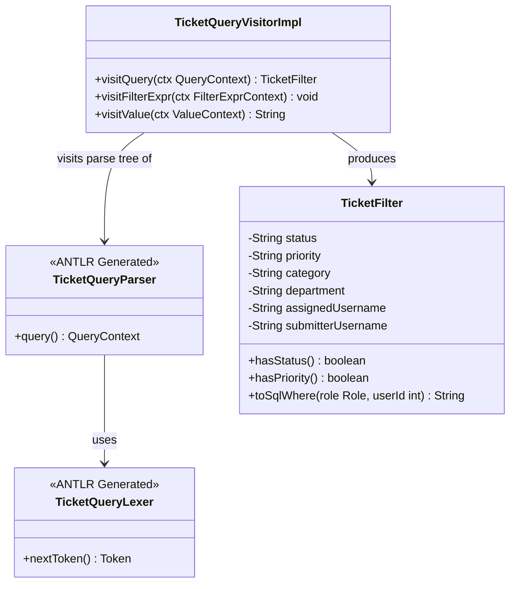

# UML Class Diagram
## CampusFlow — Smart Campus Helpdesk & Queue Management System

> **Document ID**: UML-001
> **Version**: 1.0
> **Date**: 2026-11-19

---

## 1. Overview

The class diagram covers all production classes across five logical layers:
**Model**, **Repository**, **Service**, **Server/Client Network**, and **TQL DSL**.
Enumerations and the protocol DTOs are included. UI controllers are excluded from
the class diagram (they are thin view binders with no business logic).

---

## 2. Enumerations

---

## 3. Model Layer

---

## 4. Repository Layer

---

## 5. Service Layer

---

## 6. Server & Client Network Layer

---

## 7. TQL — Ticket Query Language Layer

---

## 8. Key Design Patterns Applied

| Pattern | Where Applied | Purpose |
|---|---|---|
| **Inheritance** | `Student`, `StaffMember`, `Admin` extend `User` | Role-specific behaviour; polymorphic dispatch |
| **Strategy** | `RoutingService.route()` — strategy could be swapped for different routing algorithms | Routing logic decoupled from `TicketService` |
| **Repository** | All `*Repository` classes | Isolate data access; enable in-memory SQLite for testing |
| **DTO** | `TicketSubmitDto`, `UserCreateDto`, `AnalyticsReport` | Decouple transport from domain objects |
| **Singleton** | `DatabaseManager.getConnection()` | Single shared connection per thread |
| **Observer (implicit)** | `AnalyticsService.invalidateCache()` called after every ticket update | Cache coherence |
| **Template Method** | `ClientHandler.dispatch()` — open switch on message type | Uniform request dispatching |
| **Comparable** | `Ticket implements Comparable<Ticket>` | Natural ordering for `PriorityBlockingQueue` |

---

## Document History

| Version | Date | Author | Notes |
|---|---|---|---|
| 1.0 | 2026-11-19 | Project Team | Initial class diagram |
