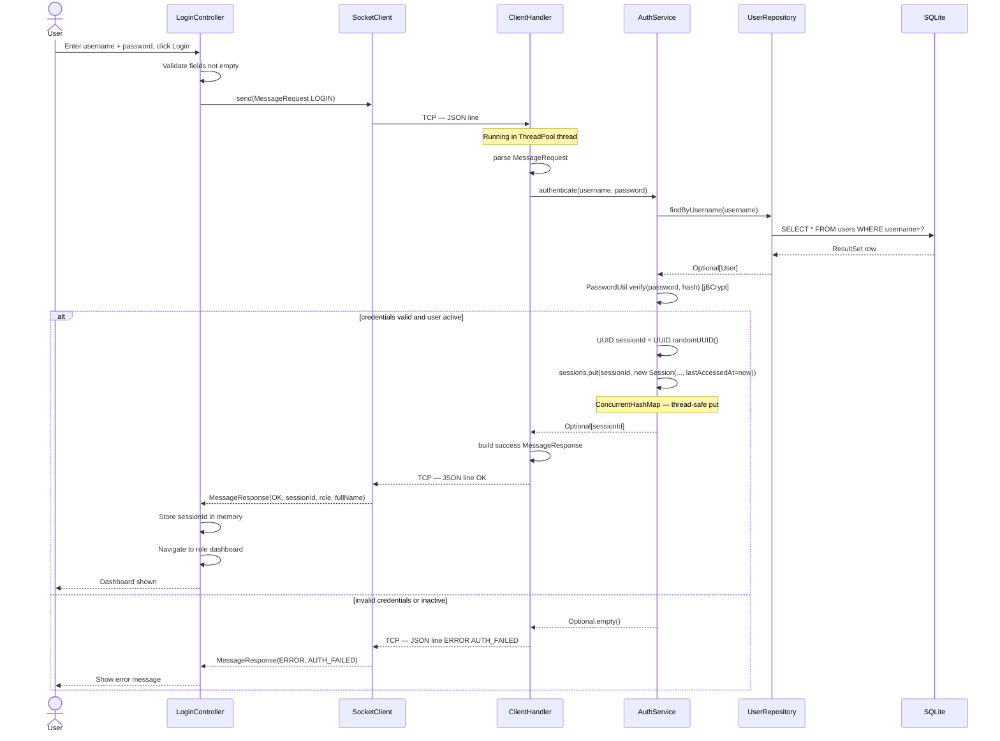
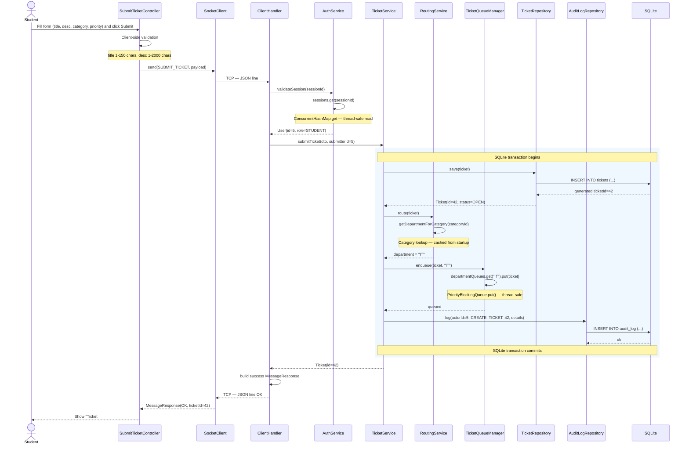
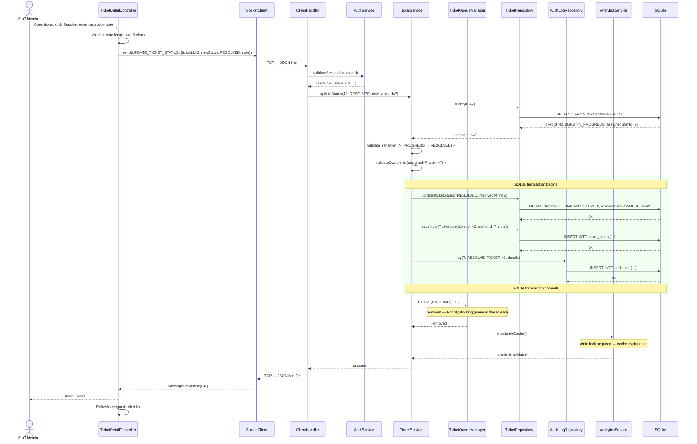
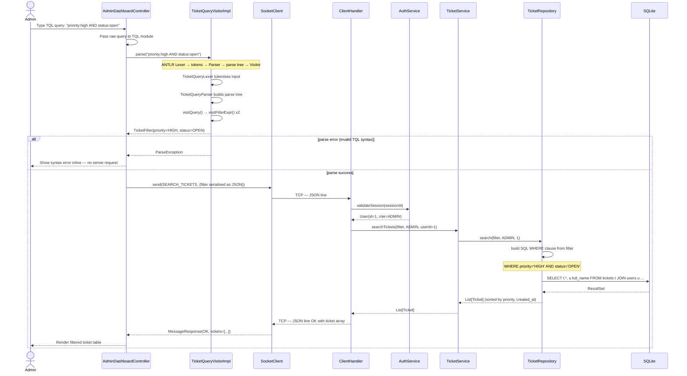

# UML Sequence Diagrams
## CampusFlow — Smart Campus Helpdesk & Queue Management System

> **Document ID**: UML-002
> **Version**: 1.0
> **Date**: 2026-11-19

---

## Overview

Four sequence diagrams are provided covering the most architecturally significant
interactions in CampusFlow:

| ID | Diagram | Key SCD Concepts |
|---|---|---|
| SD-01 | User Login | Socket communication, session management, `ConcurrentHashMap` |
| SD-02 | Complaint Submission | Socket, transaction, `PriorityBlockingQueue`, routing, audit log |
| SD-03 | Staff Ticket Resolution | Socket, concurrent state update, audit log, cache invalidation |
| SD-04 | Ticket Search with TQL | ANTLR parsing, socket, parameterised SQL |

---

## SD-01 — User Login



---

## SD-02 — Complaint Submission



---

## SD-03 — Staff Ticket Resolution



---

## SD-04 — Ticket Search with TQL



---

## Key Concurrency Interactions Highlighted

### Thread Safety in SD-02 (Complaint Submission)

Multiple students can submit simultaneously. Each `ClientHandler` runs in its own
thread from the fixed thread pool:

```
Thread-1: ClientHandler → TicketService.submitTicket() → PriorityBlockingQueue.put(ticket1)
Thread-2: ClientHandler → TicketService.submitTicket() → PriorityBlockingQueue.put(ticket2)
Thread-3: ClientHandler → TicketService.submitTicket() → PriorityBlockingQueue.put(ticket3)
```

`PriorityBlockingQueue.put()` is internally `synchronized` — no external lock
required. The SQLite `TicketRepository.save()` acquires a per-connection lock,
ensuring sequential database writes while allowing concurrent queue operations.

### ReadWriteLock in SD-03 (Analytics Cache Invalidation)

```
Resolution thread:   AnalyticsService.invalidateCache()
                       └── cacheLock.writeLock().lock()
                       └── cachedReport = null; cacheExpiry = now
                       └── cacheLock.writeLock().unlock()

Analytics read threads (concurrent, non-blocking when cache is valid):
                       └── cacheLock.readLock().lock()
                       └── return cachedReport
                       └── cacheLock.readLock().unlock()
```

### ScheduledExecutorService in Session Cleanup (SCD-02, SCD-03)

```
Session Cleaner Daemon Thread (ScheduledExecutorService, every 5 minutes):
  └── AuthService.cleanExpiredSessions()
        └── iterates ConcurrentHashMap<String, Session>
        └── if session.isExpired(30):
              sessions.remove(sessionId)
```

### Server-Side Ownership Enforcement in SD-04 (TQL Search)

When any user issues `SEARCH_TICKETS`, the server guarantees authorization regardless of client parameters:
- **Student**: `TicketRepository.search(filter, Role.STUDENT, studentId)` forcefully injects `AND t.submitter_id = ?` preventing exposure of any other student's complaints.
- **Staff**: Scoped to tickets belonging to the staff member's department or assigned tickets.
- **Admin**: Full visibility across all departments and tickets.

---

## Document History

| Version | Date | Author | Notes |
|---|---|---|---|
| 1.0 | 2026-11-19 | Project Team | Initial sequence diagrams |
